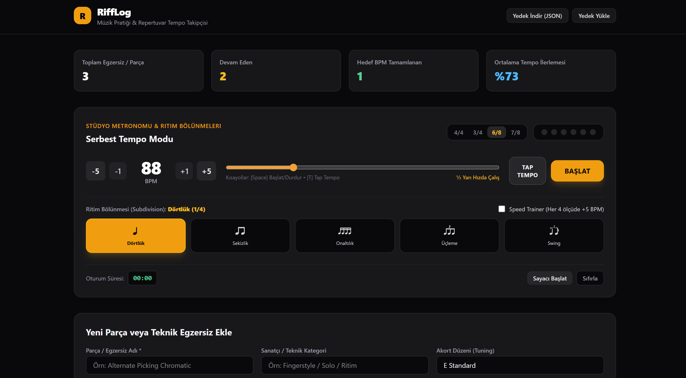
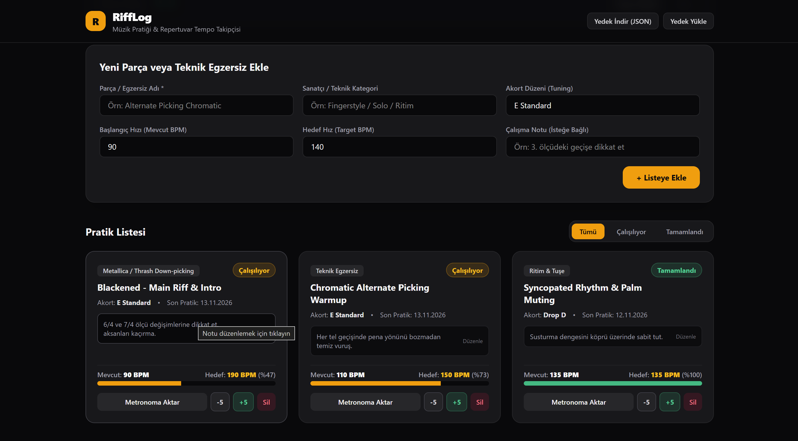

# RiffLog — Müzik Pratiği & Repertuvar Tempo Takipçisi

**RiffLog**, müzisyenlerin ve gitaristlerin çalıştıkları parçaları, teknik egzersizleri, akort düzenlerini ve hedef tempo (BPM) ilerlemelerini düzenli şekilde takip etmelerini sağlayan; dahili stüdyo metronomu ve pratik kronometresi barındıran modern bir web uygulamasıdır.

## Ekran Görüntüsü





## Öne Çıkan Özellikler

- **İnteraktif Stüdyo Metronomu (Web Audio API):** Harici bir ses dosyasına ihtiyaç duymadan tarayıcının kendi ses motoruyla 40–240 BPM aralığında hassas vuruş üretir.
- **Ölçü Birimi ve Nota Bölünmeleri (Subdivisions):** 4/4, 3/4, 6/8 ve 7/8 ölçü seçeneklerinin yanı sıra **Dörtlük (1/4), Sekizlik (1/8), Onaltılık (1/16), Üçleme (Triplet)** ve **Swing/Shuffle** ritim kalıplarıyla çalışma imkânı sunar.
- **Speed Trainer & Pratik Yardımcıları:** Her 4 ölçüde bir hızı otomatik +5 BPM artıran *Speed Trainer* modu, tek tıkla *½ Yarı Hız* geçişi, *Tap Tempo* ve oturum süresi kronometresi içerir.
- **Klavye Kısayolları:** Enstrüman çalarken kolay kontrol için `Space` tuşuyla başlatma/durdurma ve `T` tuşuyla Tap Tempo desteği sağlar.
- **Repertuvar ve Tempo Takibi:** Parça/egzersiz adı, kategori, akort düzeni (Tuning), mevcut BPM ve hedef BPM değerlerine göre otomatik ilerleme yüzdesi hesaplar ve hedefe ulaşıldığında durumu otomatik *Tamamlandı* olarak günceller.
- **Kalıcı Veri Saklama ve Yedekleme:** Tüm veriler tarayıcının `LocalStorage` alanında otomatik saklanır; ayrıca tek tıkla JSON formatında dışa aktarma (yedek alma) ve içe aktarma yapılabilir.

## Kullanılan Teknolojiler

- **React (Vite):** Bileşen tabanlı kullanıcı arayüzü ve durum (state) yönetimi
- **Tailwind CSS:** Modern, koyu tema (Dark Mode) ve duyarlı (responsive) arayüz tasarımı
- **Web Audio API:** Sıfır bağımlılıkla gerçek zamanlı metronom ses sentezi
- **LocalStorage API:** İstemci taraflı kalıcı veri depolama

## Yapay Zeka Kullanım Süreci
Bu projenin geliştirme sürecinde yapay zeka asistanı (Gemini) aşağıdaki aşamalarda aktif olarak kullanılmıştır:

Planlama ve Veri Modeli Tasarımı: Proje fikrinin belirlenmesi, bileşen mimarisinin (Metronome, StatsBar, PracticeForm, PracticeCard) kurgulanması ve LocalStorage üzerinde tutulacak JSON veri yapısının modellenmesi.

Bileşen ve Arayüz Geliştirme: React fonksiyonel bileşenlerinin oluşturulması, Tailwind CSS ile koyu stüdyo temalı duyarlı arayüzün tasarlanması ve nota bölünmeleri için özel SVG ikonlarının üretilmesi.

Teknik Fonksiyonlar ve Hata Ayıklama: Harici ses kütüphanesi kullanmadan Web Audio API ile vurgulu metronom zamanlamasının kurulması, klavye kısayolları ile metin giriş alanları arasındaki çakışmaların önlenmesi.

Dokümantasyon: Proje kurulum adımlarını, teknik mimariyi ve geliştirme sürecini özetleyen README.md dokümanının yapılandırılması.

## Kurulum ve Çalıştırma Adımları

Projeyi yerel bilgisayarınızda çalıştırmak için aşağıdaki adımları izleyin:

1. Depoyu bilgisayarınıza klonlayın:
   ```bash
   git clone [https://github.com/irembadak/riff-log.git](https://github.com/irembadak/riff-log.git)
   cd riff-log 
   
   1- Gerekli bağımlılıkları yükleyin:
     npm install
   2- Geliştirme sunucusunu başlatın:
     npm run dev
   3- Terminalde belirtilen adresi kopyalayıp tarayıcınızda açın.
   ```